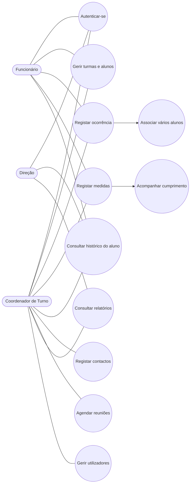

# Diagrama de casos de uso

O diagrama usa a sintaxe Mermaid suportada pelo GitHub (os actores são representados por nós e os casos de uso por elipses). Fonte: Sommerville, *Software Engineering*, capítulo 4 (modelação de casos de uso).

## Descrições resumidas

| Caso de uso | Actor principal | Fluxo principal |
|---|---|---|
| Autenticar-se | Todos | Introduzir utilizador e palavra-passe → validar → abrir sessão com perfil. |
| Gerir turmas e alunos | Coordenador, Funcionário | Criar turma/turno/curso/classe → registar aluno → consultar lista. |
| Registar ocorrência | Coordenador, Funcionário | Preencher descrição e data → seleccionar alunos → indicar testemunhas → guardar. |
| Associar vários alunos | Coordenador | Incluído no registo de ocorrência; selecção múltipla obrigatória. |
| Registar medidas | Coordenador, Funcionário | Escolher aluno envolvido → descrever medida → definir prazo → guardar. |
| Acompanhar cumprimento | Coordenador, Funcionário | Consultar medida → marcar como cumprida. |
| Consultar histórico | Coordenador, Direcção, Funcionário | Abrir aluno → ver ocorrências, medidas e encarregados. |
| Registar contactos | Coordenador | Registar data, meio e resultado do contacto com encarregado. |
| Agendar reuniões | Coordenador | Definir data, participantes e objectivo. |
| Consultar relatórios | Direcção, Coordenador | Ver ocorrências por turma e medidas por cumprir. |
| Gerir utilizadores | Coordenador | Criar conta, atribuir perfil, consultar contas. |

**Nota:** os casos de uso “Registar contactos”, “Agendar reuniões” e “Gerir utilizadores” estão previstos na lista do produto, mas só os cinco primeiros blocos fazem parte do produto mínimo da Sprint 1.
