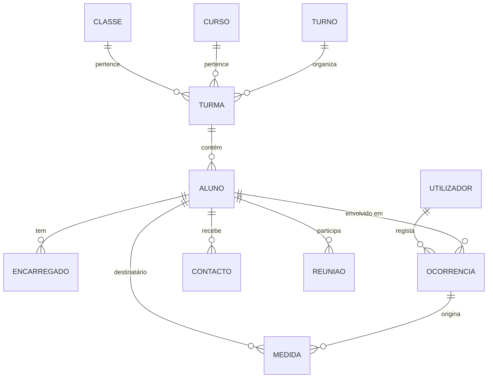

# Modelo de dados

A aplicação guarda os dados num único ficheiro JSON (`data/database.json`), criado automaticamente a partir de `src/db.js` na primeira execução. Esta opção foi escolhida porque a equipa ainda não domina bases de dados relacionais; o enunciado permite expressamente ficheiros. A alternativa relacional está descrita no final.

## 1. Estrutura do ficheiro

```text
{
  "utilizadores": [ { id, nome, username, perfil, salt, hash } ],
  "turnos":       [ { id, nome } ],
  "cursos":       [ { id, nome } ],
  "classes":      [ { id, nome } ],
  "turmas":       [ { id, nome, turnoId, cursoId, classeId } ],
  "alunos":       [ { id, nome, numero, turmaId, contacto } ],
  "encarregados": [ { id, nome, alunoId, parentesco, contacto } ],
  "ocorrencias":  [ { id, titulo, descricao, data, gravidade,
                      alunoIds[], testemunhas, intervenientes, registadoPor } ],
  "medidas":      [ { id, ocorrenciaId, alunoId, descricao, prazo, cumprida } ],
  "contactos":    [ { id, alunoId, data, meio, resumo } ],
  "reunioes":     [ { id, data, objectivo, participantes, alunoIds[] } ]
}
```

## 2. Entidades e relações



**Relações principais:**
- Uma turma pertence a um turno, a um curso e a uma classe (chaves `turnoId`, `cursoId`, `classeId`).
- Um aluno pertence a uma turma (`turmaId`).
- Uma ocorrência associa **vários** alunos através do array `alunoIds` (relação muitos-para-muitos) e regista testemunhas/intervenientes em texto.
- Uma medida pertence a uma ocorrência e a um aluno envolvido nessa ocorrência; `cumprida` é booleano.
- O histórico do aluno é uma consulta que junta `ocorrencias`, `medidas` e `encarregados` filtrados pelo `alunoId`.

## 3. Segurança dos dados

- A palavra-passe nunca é guardada: guardam-se `salt` e `hash` produzidos por `crypto.scryptSync`.
- As contas de demonstração (`coord`, `direcao`, `func`) usam todos os dados fictícios e a palavra-passe `senha123` apenas em ambiente local.
- O ficheiro gerado está no `.gitignore`, para não versionar alterações locais.

## 4. Alternativa relacional (não implementada na Sprint 1)

Se a equipa migrar para SQL, as tabelas seriam: `utilizadores`, `turnos`, `cursos`, `classes`, `turmas`, `alunos`, `encarregados`, `ocorrencias`, `ocorrencia_aluno` (tabela de junção), `medidas`, `contactos`, `reunioes`. A tabela `ocorrencia_aluno` substituiria o array `alunoIds`, mantendo a integridade referencial.
